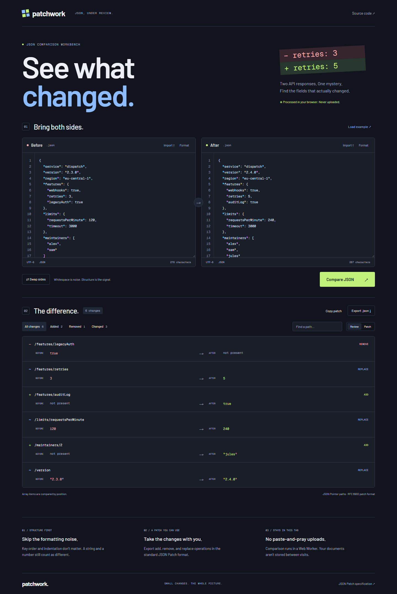

# Patchwork

Find the fields that changed between two JSON documents. Formatting is ignored; types and array positions are not. Useful for checking API responses, deployment configuration, or an unexpected fixture update.

[Try the workbench](https://goshkaaaa.github.io/patchwork/) · [Mobile screenshot](docs/mobile.png)



## Use it

Paste or import the before and after documents, then run **Compare JSON**. The sample service configuration demonstrates six changes. Filter by operation, search JSON Pointer paths, or switch to the patch view. Copy or download an RFC 6902 JSON Patch to reproduce the after document from the before document.

The comparison uses `add`, `remove`, and `replace`. Object keys are compared without regard to order. Arrays are compared by index, not by item identity: moving an item can produce multiple replacements. Array removals run from the end so earlier indices remain valid. Keys containing `/` or `~` are escaped according to JSON Pointer. Root replacements use an empty path.

Comparisons run in a module Web Worker. Inputs stay in memory and are not saved or sent to a server. Editing either input invalidates the previous result and disables patch export until another comparison succeeds.

## Run locally

Use Node.js 24 LTS.

```sh
npm ci
npm run dev
```

Open `http://localhost:3000`.

```sh
npm run lint
npm test
npx playwright install chromium
npm run test:e2e
npm run build
```

Next.js exports the site to `out/`. GitHub Pages builds set the base path to `/patchwork/`; local builds use `/`. The hosted demo is a verified static build on the separate `gh-pages` branch. Verify and Deploy demo workflows are included for accounts with GitHub Actions available. Select GitHub Actions as the Pages source to use automatic deployments.

## Code and verification

- `public/diff.js`: JSON validation, structural comparison, JSON Pointer escaping, and patch serialization. The worker imports the same module tested by Node.
- `public/diff.worker.js`: worker message boundary, including request IDs to ignore stale responses.
- `components/JsonEditor.js`: text inputs, file loading, formatting, and a bounded line-number gutter.
- `components/DiffResults.js`: review filters, path search, and patch display.

Tests cover object order, types, nulls, arrays, unusual keys, root values, and resource limits. An independent patch interpreter checks reconstruction for 400 deterministic generated document pairs. Browser tests cover imports, invalid JSON, filters, exports, semantic equality, desktop/mobile layout, and initial-screen accessibility.

## Limits

Each input allows 300,000 characters, 20,000 values, and 80 nesting levels. A comparison stops with an error above 2,000 changes; it never silently exports a partial patch. File imports are limited to 300 KB.

Parsing uses JavaScript numbers. Very large integers can lose precision; represent identifiers as strings when exact digits matter. Non-finite parsed numbers are rejected. Duplicate object keys follow `JSON.parse` behavior: the last value wins. Clipboard access needs HTTPS or localhost. The JSON download works without clipboard permission.

The UI uses optional Google Fonts, with local fallbacks. Your JSON is not included in font requests. No backend, telemetry, accounts, or API keys.

[JSON Patch specification](https://www.rfc-editor.org/rfc/rfc6902) · MIT license.
